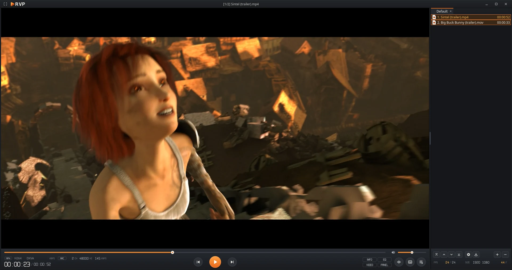
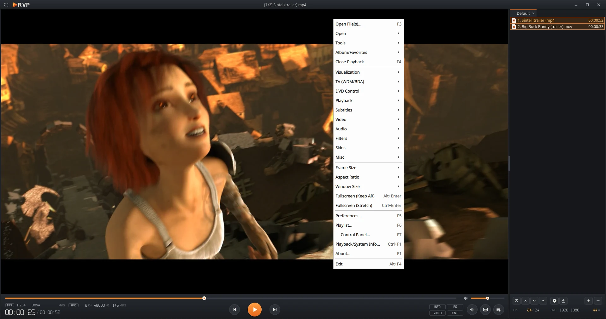
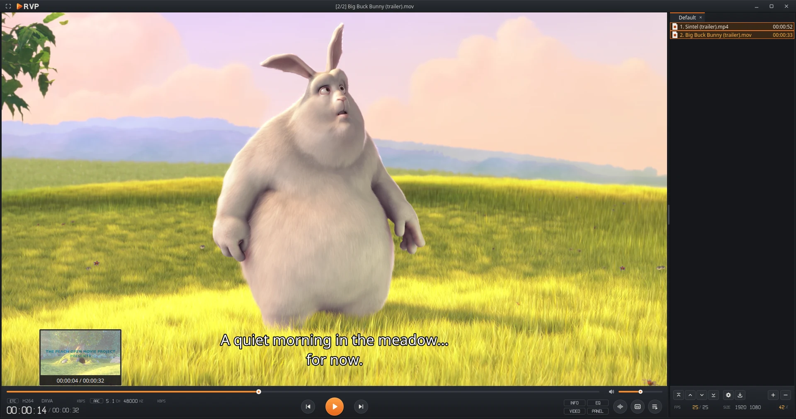
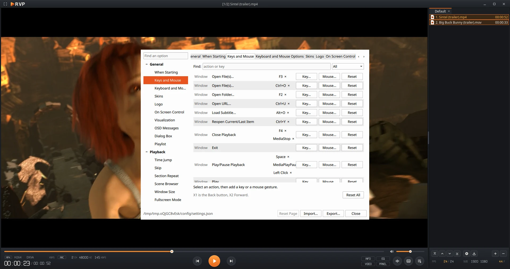
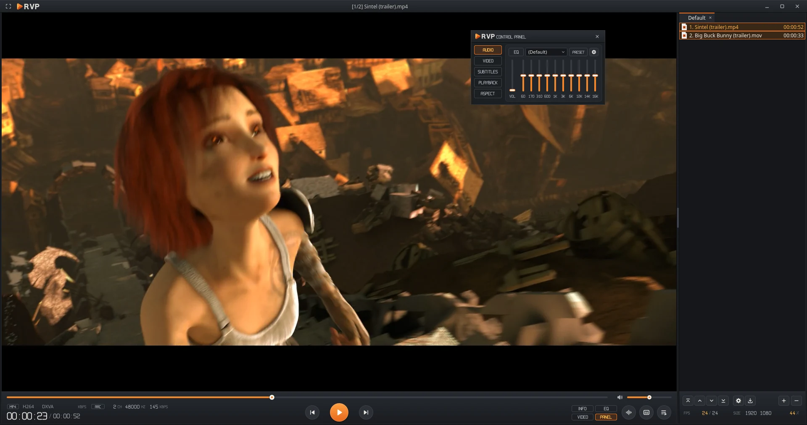
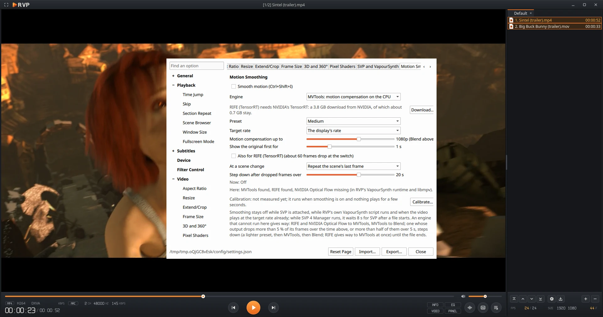

  

<h1 align="center">RVP</h1>

<b>A PotPlayer-style video player for Linux and Windows</b>

RVP (Rust Video Player) is a fan project. It was started by a long-time
PotPlayer user who wanted the player they know on Linux as well as on
Windows: the same window, the same menus and keys, the same settings and
the same sound. RVP follows PotPlayer function by function, as closely
as it can, and adds a few things of its own.

RVP is not affiliated with PotPlayer or its makers. It contains none of
PotPlayer's files: it draws its own skin and logo, and reads PotPlayer's
skins only from where you already have them.

## The idea

PotPlayer is one of the most complete video players there is, but it
runs only on Windows. RVP aims to feel familiar to anyone who uses it:

- **It looks the same.** The classic PotPlayer window, with RVP's own
  skin, RVP Default, or with the PotPlayer skins you have (BlackSpace and
  the others load as they are, colour themes included).
- **It works the same.** PotPlayer's right-click menu, its default keys
  and mouse actions, and its Preferences tree, page by page.
- **It sounds the same.** PotPlayer's volume steps and its normalizer
  were measured and reproduced: RVP's normalizer follows recordings of
  PotPlayer's within 0.1 dB.

How far it got: 548 of the 672 commands in PotPlayer's menus, 633 of the
1,040 options in its Preferences and 26 of its 29 command-line switches.
Every item that is missing is listed with the reason in
[docs/coverage](docs/coverage). They are mostly
Windows' own machinery (DirectShow filters and renderers), TV tuners,
Daum's online services, which no longer exist, and 3D subtitle modes that
mpv cannot draw; searching for subtitles online is put off for later.

## What it can do

**Playback**

- Plays almost any video or audio file, network streams, and videos from
  streaming sites (through yt-dlp, if you have it).
- DVDs and Blu-ray discs with their menus, audio CDs, webcams and capture
  devices, and screen capture.
- Hardware decoding, speed control, frame stepping, A-B repeat, skipping
  intros and endings, bookmarks and chapters.
- Remembers where you stopped in every file, and still knows it after a
  crash or a power cut.

**Playlist**

- Albums in tabs, as in PotPlayer, with shuffle, repeat and a queue.
- Imports PotPlayer's own playlists.
- Thumbnails over the seek bar and a scene browser.

**Picture**

- Brightness, contrast and colour controls, aspect ratio, crop, zoom,
  rotation and deinterlacing.
- PotPlayer's pixel shaders, translated so they run in RVP.
- Upscalers, sharpening, 3D and 360° video.
- Frame captures to a file or the clipboard, and contact sheets.

**Sound**

- A ten-band equalizer with PotPlayer's presets, the normalizer, reverb,
  Crystality and noise reduction.
- Speaker setups and downmixing, audio delay, a second audio device, and
  recording what RVP plays.

**Subtitles**

- SRT, ASS, WebVTT and the subtitles inside videos, with their styles,
  position and timing.
- A subtitle browser and editor.
- Subtitles made from a video's speech, on your own computer and offline
  (with whisper.cpp).

**Settings, keys and the control panel**

- Every key, mouse button and wheel action can be changed, starting from
  PotPlayer's own.
- Preferences with search, and presets you can switch between, export and
  import.
- The F7 control panel for sound, picture, subtitles and playback.
- The interface in fourteen languages: English, Russian, Brazilian
  Portuguese, German, Spanish, French, Italian, Polish, Ukrainian,
  Turkish, Simplified and Traditional Chinese, Japanese and Korean. RVP
  starts in the system's language. The translations were written and
  cross-checked by AI agents, so corrections from native speakers are
  welcome.

**On the desktop**

- Media keys and the system's media controls, the playback progress on
  the taskbar button, a tray icon, and file associations.
- Keeps the screen awake while a video plays and can pause when the
  screen locks.
- Can read its notices aloud and takes an Xbox controller.

## A little more than PotPlayer

- **Linux.** RVP runs on Linux as well as Windows, with the same
  settings and the same look.
- **Smooth motion without SVP.** Like PotPlayer, RVP works with SVP 4.
  It can also make films smoother by itself: five engines, from a light
  blend to motion compensation and AI-based frame interpolation (RIFE),
  two of them NVIDIA's for its cards. RVP measures what your
  computer can manage and picks the best step that keeps up.
- **A power budget for the graphics card.** RVP keeps the card under a
  share of its power by turning down its own work step by step, so heavy
  settings do not push the card to its limit.
- **Other players' skins.** Classic Winamp skins, VLC skins, and mpv's
  on-screen controllers.
- **Remote control.** A small built-in control service (off by default)
  and a ready-made remote for Unified Remote on your phone (its Full app,
  which custom remotes need).

Some things cannot work everywhere. On Linux, a Wayland desktop does not
let programs place their windows or keep them on top, and Direct3D's HDR
output and NVIDIA's RTX Video are Windows-only. Such limits are listed in
[docs/coverage/linux.md](docs/coverage/linux.md).

## How it was made

RVP was built step by step, in this order:

1. **Studies.** Can mpv's playback library carry a PotPlayer-like
   player? Does SVP work with it? Every PotPlayer key, menu item and
   setting was catalogued, and its normalizer and volume were measured.
2. **The skin engine.** RVP reads PotPlayer's skin files itself and draws
   them as PotPlayer does, checked against screenshots of PotPlayer.
3. **The player.** The window, playback and resume, then the menus and
   the settings window.
4. **Its own look.** RVP got its own logo and its own skin, drawn from
   scratch, so it needs nothing of PotPlayer's.
5. **Packages.** Installers for Windows and packages for Linux, and the
   desktop's file associations and media controls.
6. **Parity, area by area.** Sound, playback and the playlist, the
   picture and the window, subtitles, the remaining preferences and
   skins, remote control, and DVD and Blu-ray menus. Each area was
   compared with PotPlayer item by item, and every gap got its reason.
7. **Other players' skins** (Winamp, VLC, mpv's controllers).
8. **Smooth motion without SVP.** First a study of the engines that
   exist, then RVP's own smoothing and the power budget.
9. **Linux.** The Linux side of every part, then checks on a real Linux
   PC with an NVIDIA card, an audit of the Linux version, and its fixes.

Changes are checked on both Windows and Linux. RVP has built-in
self-tests that drive the player as a user would, and the sound and the
skins were compared with recordings and screenshots of PotPlayer itself.
The full plan and the report of each step are in [docs](docs).

## Getting RVP

RVP is in alpha. The first pre-release, 0.1.0-alpha.1, is on the
[Releases](https://github.com/woffko/rvp/releases) page:

- **Windows** (10 and 11, 64-bit): an installer (for the current user
  only, no administrator rights) and a portable ZIP. The first alpha's
  were withdrawn on 2026-11-21; they return with the next alpha.
- **Linux** (64-bit): a .deb package (Ubuntu 22.04 and newer) and an
  AppImage; the repository also has an Arch Linux (AUR) recipe.

Expect rough edges: report what breaks with the version from the About
window.

For building from source and the developers' notes, see
[AGENTS.md](AGENTS.md) and [docs/PLAN.md](docs/PLAN.md).

## Thanks

RVP stands on the work of others: mpv and FFmpeg play the media, Qt
draws the windows, VapourSynth, MVTools and RIFE smooth the motion,
whisper.cpp writes subtitles, libdvdnav and libbluray play the discs.
And PotPlayer, the player it all started from.

The screenshots show frames from *Sintel* and *Big Buck Bunny*,
© Blender Foundation, under the Creative Commons Attribution 3.0 licence
([durian.blender.org](https://durian.blender.org),
[peach.blender.org](https://peach.blender.org)); the subtitle text is
RVP's own. `tools/screenshots/tour.sh` takes them.

## License

GPL-3.0-or-later. See [LICENSE](LICENSE).
